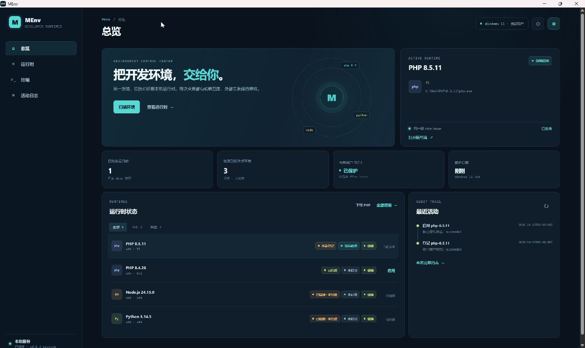
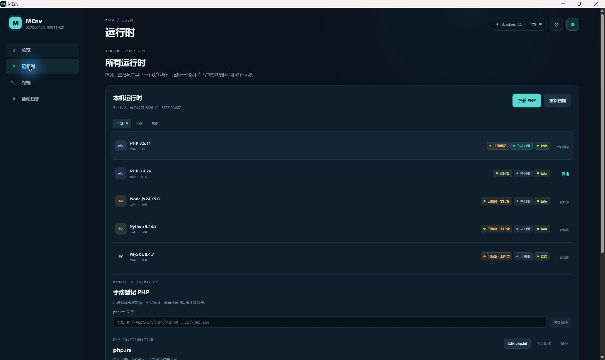
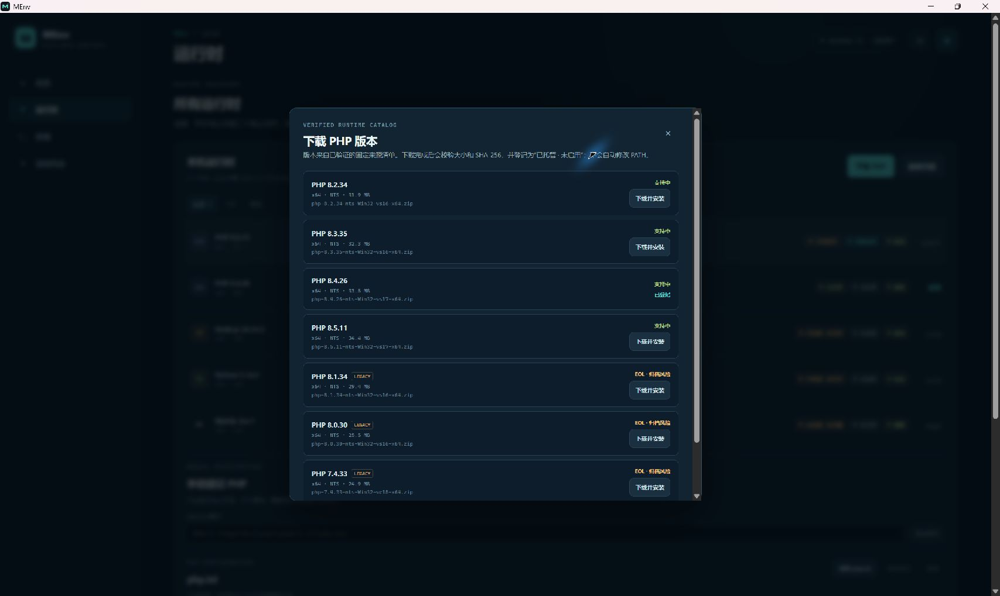

# MEnv · Windows 开发环境管理器

**在一个面板中查看本机环境，下载、登记并切换 PHP 版本。**

MEnv 面向需要管理多个本地开发环境的 Windows 开发者，目前重点提供 PHP 多版本管理。
你可以从已验证的官方来源清单下载 PHP，也可以登记已有的 `php.exe`，在确认后启用所需版本。
面板分别显示安装来源、启用状态和健康状态，帮助你看清“电脑上有哪些环境”和“当前启用了哪个版本”。

[下载 EXE 安装包](https://github.com/cxszn/cxszn_menv/releases/download/v0.0.2/cxszn_menv_0.0.2_x64-setup.exe)
· [下载 ZIP 程序包](https://github.com/cxszn/cxszn_menv/releases/download/v0.0.2/cxszn_menv_0.0.2_windows-x64.zip)
· [版本发布页](https://github.com/cxszn/cxszn_menv/releases/tag/v0.0.2)
· [详细使用说明](./docs/windows-preview.zh-CN.md)

> 当前版本为 **0.0.2 未签名开发者预览版**，首发支持 **Windows 11 x64**。
> PHP 提供版本管理；Node.js、Python 和 MySQL 客户端目前仅支持只读检测。

## MEnv 能做什么

| 使用场景 | 对应能力 |
| --- | --- |
| 了解电脑上已经装了哪些开发环境 | 扫描 PHP、Node.js、Python 和 MySQL 客户端，查看路径、版本和状态 |
| 为不同项目准备 PHP 版本 | 下载应用清单中可用的 PHP 构建，或登记已有的 `php.exe` |
| 选择当前使用的 PHP | 查看变更计划并确认启用；切换结果对新终端生效 |
| 检查 PHP 配置 | 只读查看 `php.ini`、检查格式，并在确认后创建备份 |
| 使用命令行或接入 AI 工具 | 提供 JSON CLI、本机 stdio MCP 和操作 Skill；写操作仍需确认 |

安装、登记和启用是不同操作：新安装或新登记的 PHP 默认未启用。
应用只维护自己的用户级环境入口，外部 PHP 安装目录保持原样。

## 快速上手

### 1. 下载并打开

从上方链接选择一种方式：

- **EXE 安装包**：按安装向导完成当前用户安装，再打开 MEnv。
- **ZIP 程序包**：解压后运行 `cxszn-menv.exe`；电脑需要已安装 Microsoft Edge WebView2 Runtime。

EXE 内嵌 WebView2 引导程序，缺少 Runtime 时仍需联网获取。ZIP 是免安装程序包，
数据仍保存在当前用户的 `%LOCALAPPDATA%\cxszn-menv`，不会随解压目录自动迁移。

### 2. 找到或准备 PHP

打开左侧 **“运行时”**。没有扫描历史时会自动进行首次扫描，之后可点击 **“重新扫描”**。

| 你的情况 | 操作 |
| --- | --- |
| 电脑上已经有 PHP | 在列表中找到它；未检测到时，在“手动登记 PHP”中填写 `php.exe` 的绝对路径，点击“验证路径”，再“确认登记” |
| 还没有需要的 PHP 版本 | 点击“下载 PHP”，选择可用构建，点击“下载并安装”，核对计划后“确认下载” |

可下载版本以应用中的已验证清单为准；并非 PHP 5.6–8.5 的所有版本和 TS/NTS 组合都有下载入口。

### 3. 确认启用

在目标 PHP 行点击 **“启用”**，核对弹窗中的版本、路径和影响范围，再点击 **“确认启用”**。
成功后，该行显示 **“当前启用 / 当前版本”**。需要切换时，对另一个 PHP 版本执行同一确认流程。

### 4. 在新终端中验证

新开一个终端，执行：

```powershell
where.exe php
php -v
```

第一条列出找到的 PHP 程序路径，第二条确认当前命中的 PHP 版本。已有终端不会自动切换，
请使用新窗口或新会话。编辑器内新标签页可能继承编辑器启动时的环境，必要时重新打开编辑器后再验证。
也可以在 MEnv 的“终端”页创建新会话；内嵌终端的完整用户验收仍在继续。

## 界面示例

以下为 **0.0.2 真实程序截图，使用演示环境数据**，用于说明界面和操作入口；
图中的路径、版本状态和活动记录不代表本机安装验收结果。下载清单以实际打开应用时为准。

### 总览：查看当前 PHP 与环境状态

集中查看当前启用的 PHP、受管与外部环境数量，以及近期操作记录。



### 运行时：区分安装来源、启用状态和健康状态

PHP 可以选择版本启用；Node.js、Python 和 MySQL 客户端显示为“仅检测”。
手动登记入口位于列表下方。



### 下载 PHP：先选择构建，再确认安装计划

清单显示版本、架构、TS/NTS、下载大小与维护状态。旧版会显示 legacy/EOL 提示，
所有下载均需确认安装计划，安装完成后仍保持未启用。



## 实现范围与预览版说明

MEnv 是 Windows 11 优先的多运行时开发环境管理器。`0.0.2` 当前是 unsigned developer preview，交付了 PHP 只读扫描/手动探测、Node/Python/MySQL client 只读扫描、HKCU PATH lease、app-owned shim、共享 Rust application service、Tauri NSIS current-user 安装包、ConPTY 结构化适配器、Ed25519 catalog 信任根/官方 PHP artifact 清单和安全安装器 adapter。Node/Python/MySQL 尚未接入安装、切换或 PATH 接管；macOS 仍只保留扩展契约。

安装后的 `cxszn-menv.exe` 提供 JSON CLI：`doctor`、`runtimes list`、`runtime scan/verify`、`catalog list --kind php`、`operation get/cancel`，以及 `runtime add/enable/disable` 的 `change plan → change confirm → change apply`；写操作仍必须经过共享确认边界。

版本变更见 [CHANGELOG.md](./CHANGELOG.md)，发布门禁见 [tasks/release-0.0.2.md](./tasks/release-0.0.2.md)。
当前仓库尚未声明开源许可证；本版本源码公开不等于授予生产、再分发或商用许可。
这是 `0.x` 预览 API，公共 JSON、CLI 和 MCP schema 仍可能在后续版本发生不兼容调整。
安全问题报告方式见 [SECURITY.md](./SECURITY.md)。

`0.0.2` 以 GitHub prerelease 形式交付，仍是未签名开发者预览版。下载
[EXE 安装包与 ZIP 程序包](https://github.com/cxszn/cxszn_menv/releases/tag/v0.0.2)，
使用说明见 [Windows 预览版说明](./docs/windows-preview.zh-CN.md)。catalog/GUI 完整回滚、
终端、干净机和正式发行门禁仍待完成；第三方声明见 [THIRD-PARTY-NOTICES.md](./THIRD-PARTY-NOTICES.md)。

## 已实现的边界

- PHP 探测使用绝对本地路径，解析版本、x64/x86、TS/NTS、`php --ini` 和健康诊断；支持 5.6–8.5 的版本模型，未验证的组合不会被标成可下载。
- PHP 详情页支持读取并本地只读验证 `php.ini` 的节、指令、重复键和截断状态；不会执行配置、修改文件或自动调参。
- Windows 扫描已增加 Node.js 只读 RuntimeProvider：检查 PATH、常见 nodejs 目录和 nvm-windows 版本目录，探测版本/架构但不接管 PATH 或 nvm。
- Windows 扫描也增加 Python 只读 RuntimeProvider：检查 PATH、`PYTHONHOME`、常见 Python 目录并区分 `python.exe`/`py.exe` launcher，探测版本/架构但不接管 `py.exe`、venv 或 PATH。
- Windows 扫描也增加 MySQL/MariaDB client 只读 RuntimeProvider：仅执行本地 `mysql.exe --version`，不连接服务、不启动服务、不访问数据目录。
- 扫描默认为只读，状态分离为 availability、ownership、activation、health 和 operation；手动路径只登记元数据，不复制、覆盖或删除原文件。
- 首次启动在没有历史扫描记录时自动执行一次只读环境扫描；之后保留空环境结果，不反复扫描或自动接管外部运行时。
- Tauri 面板已支持手动登记 PHP：绝对路径验证后必须确认 plan，新登记默认为 manual/disabled；已有同路径记录的启用状态会保留，不会因登记修改 PATH 或外部文件。
- 手动登记会写入共享 operations 审计记录，使用 plan id 和幂等 key，重试不会重复登记。
- catalog PHP 安装成功后同样写入 `install` operation，活动日志和状态快照可追踪安装结果。
- catalog 安装失败会返回明确的 `HASH_MISMATCH`、`SIZE_MISMATCH`、`ARCHIVE_REJECTED`
  或 `DOWNLOAD_FAILED` 等错误码，不会统一伪装成平台错误。
- 变更统一走 `plan → host-issued confirmation token → apply`，有 plan hash、过期、actor、幂等 key 和操作状态；CLI/MCP 共享稳定 envelope。MCP 本身不从模型文字生成 token。
- PHP 下载计划在桌面重启后可恢复未过期的确认对话框；恢复过程只读，不会绕过用户确认自动下载。
- MCP 仅本机 stdio，stdout 只输出 JSON-RPC；当前工具不暴露任意 shell、URL 下载、artifact 安装或文件删除。Skill 随源码提供并通过静态校验，尚未证明已被 Codex runtime 自动发现。
- `catalog/trust/runtime-root.json` 和 `catalog/manifests/php-windows-official.json` 是可审计的静态签名清单；`pnpm catalog:verify` 只生成不写盘的下载计划。
- 当前 catalog 可下载 PHP 8.2.34、8.3.35、8.4.26、8.5.11，以及标记为 EOL/legacy 的 8.1.34、8.0.30、7.4.33；5.6 和更老的 7.x 因缺少可验证官方 x64 artifact 暂不显示为可下载。
- `crates/platform-windows/src/install.rs` 的 adapter 已实现固定来源、大小/SHA、Zip 安全检查和原子目录发布契约；Tauri GUI 已接入 PHP catalog 列表、确认计划和安装动作，安装完成仍保持 disabled，不附带 PHP、Node、MySQL 或 Python 二进制。
- PHP shim 同盘使用 hard-link，跨盘（例如 `R:` PHP 与 `C:` 用户数据根）使用受信任的 `cxszn-menv.exe` launcher 转发，不复制 PHP 本体；新终端才会读取更新后的用户 PATH。
- 内嵌 PowerShell 终端启动时会读取当前共享 PATH lease 快照，显式注入新会话环境；已有会话不会热切换。
- 桌面端已接入固定 Windows PowerShell 的终端生命周期命令：启动、输入、输出轮询和关闭；命令不接受任意 executable 或启动参数。GUI-subsystem ConPTY child I/O、输出上限和 wait/shutdown 已在 Win11 x64 实测通过；console-host child-I/O 用例因宿主输出竞态保持 ignored，完整嵌入终端用户验收仍待完成。
- Windows bundle workflow 故意产出 unsigned NSIS developer artifact；本机安装/启动/卸载 smoke 已通过，不能据此宣称 SmartScreen 或发行商信任。NSIS 内嵌 WebView2 bootstrapper，安装时仍需要网络；完全离线安装包尚未纳入。
- Windows NSIS 默认安装目录名称为 `cxszn_menv`；显示名称仍为 `MEnv`。用户可以选择其他本地目录，例如 `R:\App\Code_Tool\cxszn_menv`。

## 当前验证边界

本机已验证 Node/pnpm、Rust/Cargo、Visual Studio MSVC；`cargo check/test/clippy`、隔离状态全量测试、HKCU PATH/shim roundtrip 和 unsigned NSIS 构建/既有 smoke 均有证据。Rust/Tauri 环境状态和 PHP install plans 默认使用 `%LOCALAPPDATA%\\cxszn-menv\\state-rust.sqlite3` 的 SQLite/WAL adapter，并从旧 JSON 文件迁移；安装 journal 仍以 JSONL 作为恢复源并镜像到 SQLite 审计表，统一 journal 事务和完整崩溃恢复仍未完成。GUI-subsystem ConPTY child I/O、输出上限和 wait/shutdown 已在 Win11 x64 通过；console-host child-I/O 用例因宿主输出竞态保持 ignored。七个 PHP catalog artifact 的 adapter live 安装已通过，Tauri GUI 回滚和用户可见验收仍未通过。

## 开发命令

```powershell
pnpm install
pnpm test
pnpm typecheck
pnpm build
```

首选验证命令是 workspace 命令：

```powershell
pnpm test
pnpm typecheck
pnpm build
pnpm lint
pnpm validate:contracts
pnpm catalog:verify
```

如果本机 pnpm registry 或 workspace 链接异常，当前工作区还保留以下仅供本机
排障的直接验证命令；其中 `node_modules/.ignored` 是本机依赖布局，不是发布契约：

```powershell
node node_modules/.ignored/vitest/vitest.mjs run --reporter=dot
node node_modules/.ignored/typescript/bin/tsc --noEmit --typeRoots node_modules/.ignored/@types -p packages/core/tsconfig.json
node node_modules/.ignored/typescript/bin/tsc --noEmit --typeRoots node_modules/.ignored/@types -p packages/cli/tsconfig.json
node node_modules/.ignored/typescript/bin/tsc --noEmit --typeRoots node_modules/.ignored/@types -p packages/mcp/tsconfig.json
npm --prefix apps/desktop run build
.\\.agents\\skills\\cxszn-menv-operator\\scripts\\validate-contract.ps1 -RepoRoot .
node node_modules/.ignored/tsx/dist/cli.mjs packages/mcp/scripts/validate-contracts.ts
```

上述 workspace 验证已取得：TypeScript/Vitest 测试、Core/CLI/MCP 类型检查、桌面端和 Tauri 前端 Vite build、CLI lint、catalog/Skill validator、8 个 MCP 工具 schema，以及 Windows MSVC `cargo check/test/clippy`。Windows 11 HKCU PATH/shim、ConPTY child I/O 和 unsigned installer smoke 有实机证据；artifact 安装回滚和完整 GUI 用户验收仍未取得证据。

安全和协作规则见 [AGENTS.md](./AGENTS.md)。
